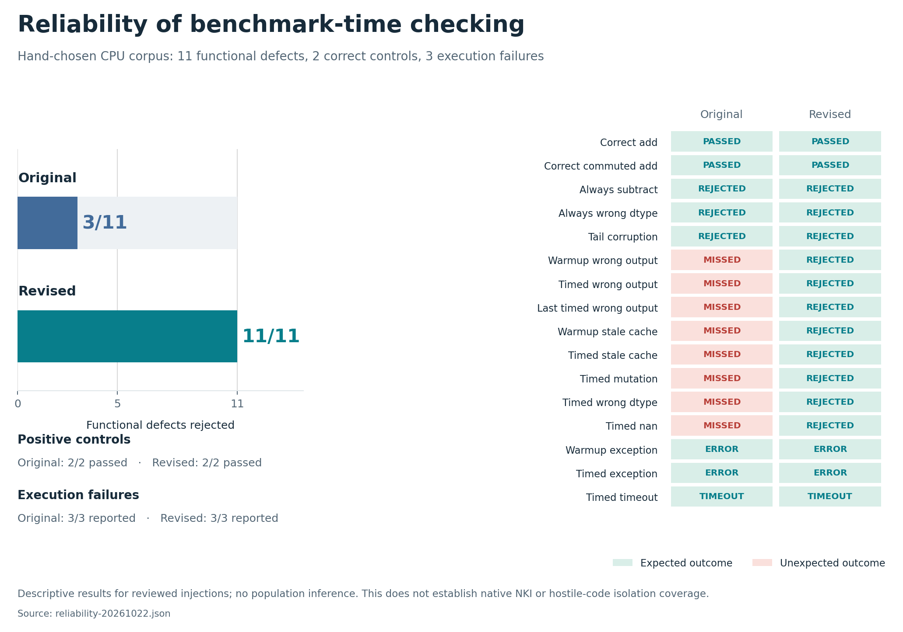
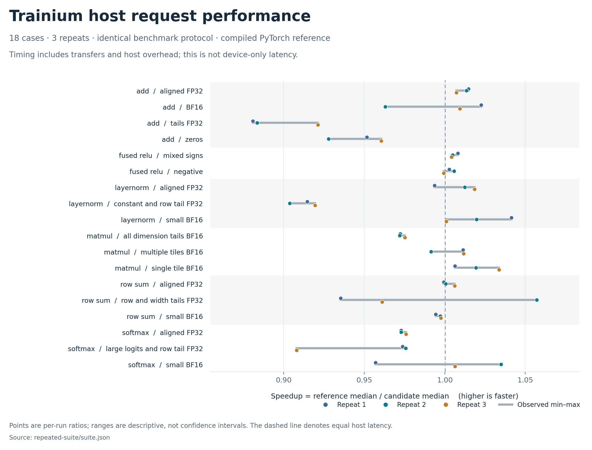

# NKI evaluator progress and PI demonstration

22 October 2026. We have expanded a working PyTorch-to-NKI evaluator into a reproducible
validation and measurement system. The strongest new result is improved rejection of known
functional failures, accompanied by broader real Trainium coverage. The current kernels are
simple reference implementations; this update does not establish an optimization win.

## Completed results

| Area | Measured result | Evidence |
| --- | --- | --- |
| Local regression suite | 105 passed; 16 optional real-SDK tests skipped in that local invocation | Test suite; native runs recorded separately |
| CPU failure-injection comparison | Baseline rejected 3/11 functional mutants; revised evaluator rejected 11/11. False accepts fell from 8 to 0. Both controls passed in both versions. | [32-run matrix](../benchmarks/reliability-20261022.json), [analysis](reliability-results.md) |
| Execution failures | Both versions reported all three injected exception/timeout cases | Same matrix; counted separately from contract failures |
| New native operators | Row sum, softmax, LayerNorm and matmul: all 12 cases passed simulator and Trainium, without source or tolerance repairs | [Native reports](../validation/native-20261022/native-new-families-summary.json) |
| Repeated Trainium study | Six families, 18 cases, three repeats: 18/18 evaluations and 54/54 case runs passed | [Table](../validation/repeated-suite/suite.md), [raw suite](../validation/repeated-suite/suite.json) |
| Native negative controls | Incorrect arithmetic and incorrect tile tails both rejected by simulator and hardware; compiled baselines passed | [Simulator](../validation/native-negative-20261022/simulator.json), [hardware](../validation/native-negative-20261022/neuron.json) |
| Device profiling compatibility | Captured one profiled execution each for NKI and compiled PyTorch on a BF16 matmul case | [Scope, timings and evidence](profiling-results.md) |
| Packaging | Source archive and wheel build succeeded; Ruff and formatting checks passed | Project build and CI configuration |

The repeated study used five initial correctness trials, 20 warmups and 200 timed pairs per case.
It therefore checked 270 initial candidate/baseline trial pairs and 11,880 warmup/timed pairs.
Candidate and baseline outputs were each compared with eager PyTorch. Input generation, oracle
execution and checking were outside the timing interval. The same evaluator module hashes were
verified on the local checkout and the Trainium host; [hashes are retained](../validation/evaluator-source-sha256.json).

## Reliability improvement

The original benchmark discarded outputs after the initial correctness stage. It could accept
implementations that returned stale cached values, changed dtype, mutated inputs, or became wrong
only during warmup or timing. The revised `fresh_inputs_checked_v1` protocol generates fresh
deterministic input pairs and verifies every candidate and baseline output throughout the run.
Any failure removes all case and aggregate performance results, including earlier timings.



This is a hand-chosen set of 11 functional-contract mutants and two correct controls, not a
population estimate. It validates the shared CPU harness behavior, while the separate native
negative controls validate two NKI rejection paths. Submitted code still shares a process with
the checker and can inherit host privileges; these results do not establish secure untrusted
execution. The [full evidence archive](../validation/reliability-evidence-20261022.tar.gz) includes
the frozen experiment driver, source snapshots, candidates, reports and logs.

## Performance result and interpretation

The repeated experiment used one visible NeuronCore on `trn1.2xlarge`, with NKI 0.3,
torch-neuronx tracing, target `trn1`, and compiler autocasting disabled for both implementations.
It measured serial host requests, including transfers and completion, against compiled PyTorch.

The equally weighted geometric mean of case-level median speedups was **0.984×**. Case medians
ranged from **0.884× to 1.020×**. No case's median ratio exceeded 1.05×. Individual repeats are
shown below; their ranges are descriptive, not confidence intervals.



For example, the row-sum tail case ranged from 0.935× to 1.057× but had a median of 0.961×.
Selecting its best run would create a misleading speedup headline. The data support repeatable
measurement and a working baseline comparison, with optimization left as future work. Matmul's
contract takes a pretransposed contiguous left operand, so its timings exclude layout preparation.

The 21 October timings used repeated fixed inputs without benchmark-time checking. They remain
available as [historical evidence](../validation/trainium-20261021.json) and are not pooled with
this revised protocol. Outside-timer validation changes the surrounding cache/workload state.

Device profiling now works for one BF16 matmul case whose compiled implementations had passed
the seeded evaluator. One profiled execution per model reported **22.360086 µs** for NKI and
**23.202204 µs** for compiled PyTorch. These captures used profiler-default inputs without seed
replay or output validation; they measure device execution and exclude host overhead and transfers.
They establish profiler compatibility, not a repeatable speedup or an additional correctness result.
The [profiling report](profiling-results.md) records the exact scope and links the preserved evidence.
The Trainium instance was confirmed stopped after this session.

## Five-minute demonstration

1. Show one reference, kernel and workload, then its saved passing native report.
2. Run a native negative control and show the numerical failure and missing performance result.
3. Open the reliability matrix to show how delayed corruption passed the old evaluator and fails the revised one.
4. Show the three-repeat plot, baseline definition and raw report behind a selected point.
5. Show the completed profiling smoke test, then explain the next experiments: held-out defects,
   repeated device captures with saved validated inputs, and structured repair feedback.

To reproduce the native negative-control check in the activated SDK environment:

```bash
PYTHONPATH=src NEURON_PLATFORM_TARGET_OVERRIDE=trn1 NEURON_RT_VISIBLE_CORES=0 \
  python scripts/check_native_failures.py --backend neuron \
  --output-dir runs/demo-negative
```

See [benchmark instructions](benchmarking.md) for the full three-repeat suite and
[reliability instructions](reliability-results.md#reproduction-and-evidence) for the local comparison.
Plotting uses matplotlib and the saved JSON; it does not rerun evaluations.

## Research direction

The [literature survey](literature-survey.md) covers existing NKI benchmarks, generation systems,
and mutation analysis of benchmark oracles. It rules out an unsupported “first NKI evaluator”
claim. The current contribution is a reproducible NKI-specific engineering study; research
novelty remains to be established through the planned experiments.

The [full plan](research-plan.md) prioritizes a held-out defect set, repeated device profiling with
saved inputs and output validation, and a controlled comparison of binary versus structured repair feedback. Distributed
training and large generation sweeps follow only if these smaller experiments justify them.
